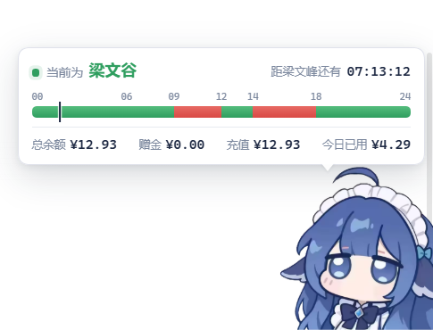
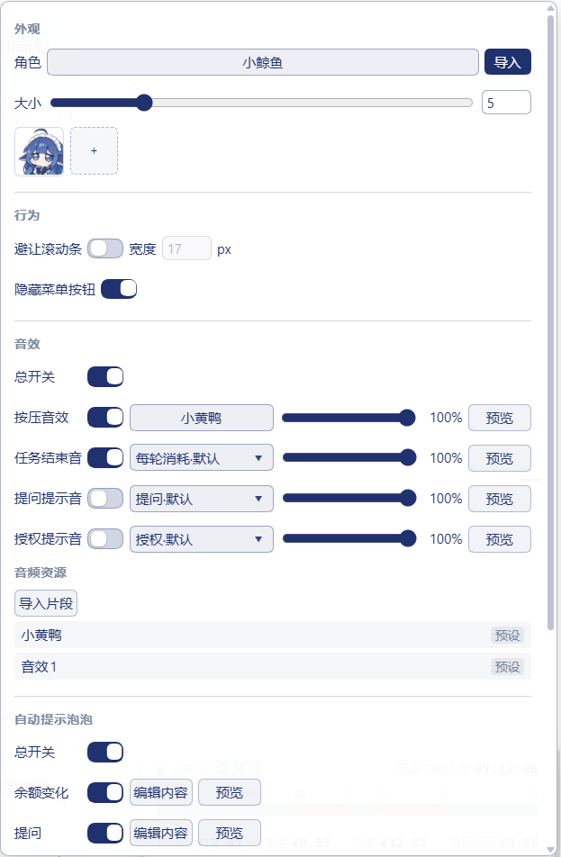

# dsh-whale-pro

<p align="center">
  
</p>

<p align="center">
  <strong>DSH 桌面端小鲸鱼简洁版</strong><br>
  常驻梁文峰/梁文谷/时间线/余额信息栏，大幅优化原插件冗余部分。
</p>

> 插件包名、挂载 id 与 GitHub 仓库名统一为 **dsh-whale-pro**。

> 本仓库是 [DeepSeek-Balance-Whale-Widget](https://github.com/MeteorNOX/DeepSeek-Balance-Whale-Widget) 的简洁分支（fork），基于上游 0.4.2 改造。原始代码与素材版权归上游作者所有，详见 [LICENSE](LICENSE) 与 [PROVENANCE.md](PROVENANCE.md)。

## 展示

| 常驻信息栏 | 设置页 |
| :---: | :---: |
|  |  |
| 梁文峰 / 梁文谷 / 时间线 / 余额 / 今日已用 | 外观、行为、音效、自动提示泡泡 |

## 特性

- **常驻信息栏**：在鲸鱼头顶显示余额、赠金、充值余额、今日已用。
- **峰谷进度条**：梁文峰 / 梁文谷 / 时间线连续展示，带当前时间线。
- **独立自动泡泡**：余额变化、提问、每轮消耗、授权、余额预警、今日预算；每种都有独立开关、内容编辑和预览。
- **移除手动点击泡泡**：点击鲸鱼不再打开旧的大泡泡；自动提示泡泡保留。
- **内联设置页**：外观 / 行为 / 音效 / 自动提示泡泡四类，横线分隔，胶囊开关，修改即时生效。
- **音效管理**：按压、任务结束、提问、授权四类音量与试听；音频片段导入、试听、删除；音效组选择。
- **图片管理**：角色图在「外观」中管理并可直接删除；泡泡图片库在「自动提示泡泡」中管理。
- **本地记账**：余额变化按观测累计今日已用；数据保存在本机 `$DSH_HOME`，API 密钥通过宿主凭据服务管理，不写入插件配置。

## 界面与操作

- 右下角鲸鱼头顶显示紧凑信息栏。
- 菜单按钮打开设置页；隐藏菜单按钮后，右键鲸鱼（移动端长按约 1.5 秒）唤出。
- 设置页分类：
  - **外观**：角色、大小、角色图管理。
  - **行为**：避让滚动条、隐藏菜单按钮、文字框显示开关。
  - **音效**：总开关、按压音效、任务结束音、提问提示音、授权提示音、音频资源。
  - **自动提示泡泡**：总开关、六种场景、泡泡图片库。
- 两处「总开关」关闭后，对应分组整体变灰且不可操作。
- 音量滑条范围 0–100，默认 100%。

## 前置条件

- **宿主认证能力是必需条件**：DSH 必须提供 `connection.requestRejection(req)`，请求须通过宿主登录认证。认证接口缺失、服务查找失败、调用异常或返回值不符合约定时，插件路由拒绝访问（HTTP 503）；宿主返回的 401/403 会保留。不会退回仅凭回环地址或来源头放行。
- 写操作默认还要求真实连接对端和请求 Host 都是回环地址。远端管理须同时通过宿主认证和宿主的可信主机检查，并显式配置 `DSHW_ADMIN_HOSTS`（逗号分隔，可带端口）；该设置不能关闭认证。反向代理部署还须在代理入口限制管理访问，插件不信任 `X-Forwarded-For` 等头来证明本机身份。
- 余额取数优先使用 DSH 凭据中的 `DEEPSEEK_API_KEY`；如果只登录了 DeepSeek 账号、没有配置 API key，较新的 DSH 会自动使用账号登录态。
- 未配置凭据时挂件仍会加载，但余额/今日已用等数据会显示为空或 `—`，不会影响 DSH 本身。
- 插件面向 DSH Desktop；Web 模式也可以安装，但桌面端请用宿主内置的 `plugin_manager`。
- 凭据读写限于内置厂商凭据名和 `DSHW_` 开头的自定义名字（最多 64 个字母、数字或下划线）。升级前若使用其他自定义名字，需要在模型设置中改用 `DSHW_` 名字并重新配置密钥；插件不会自动改名或删除旧凭据。
- 自定义接口仍支持本机模型与内网网关；云元数据、link-local、映射后的危险 IP 及解析到这些地址的域名会被拒绝。余额、额度和探活接口不跟随重定向，请填写最终地址。

## 安装

### 让 AI 帮你装（推荐，直接复制）

把下面整段发给 DSH 里的 AI，或任意能执行命令的 AI：

```text
请帮我安装/更新 DSH 插件 dsh-whale-pro，仓库地址：
https://github.com/Cdkgfp/dsh-whale-pro

先判断当前运行形态，再选择对应安装方式：
- 官方桌面客户端（Desktop / Electron）：使用宿主内置的 plugin_manager 安装
  github:Cdkgfp/dsh-whale-pro；不要执行 dsh plugin --profile desktop ...，
  也不要手工修改 desktop profile 或宿主托管的 package.json / pnpm-lock.yaml。
- dsh web / CLI：执行
  dsh plugin --profile web add github:Cdkgfp/dsh-whale-pro

安装前检查是否已存在旧安装（dsh-whale-compact 或 dsh-whale-pro）：
- 先报告当前 profile、来源和版本；
- 需要替换旧包时，用宿主支持的方式先卸载，再安装新包；
- 不要删除用户的账本、设置、角色图、音频、泡泡图片或凭据；
- 不要为了安装直接改写宿主 profile 文件，也不要绕过 desktop profile 的限制。

如果 plugin_manager 不接受 github: 安装源：
- 把仓库克隆到一个固定、不会移动的目录；
- 再用 plugin_manager 的本地 link: 方式安装该目录；
- 最后确认挂载 id 和包名都是 dsh-whale-pro。

安装后核对并告诉我：
1) 当前 profile 的 bundles 里是否有 dsh-whale-pro；
2) 插件版本是否为 0.4.4；
3) 是否需要完全退出 DSH（含托盘）再重新打开。

不要自动重启 DSH。如果需要重启，只提示我手动操作；不要索要或上传我的 API key、token 或凭据。
```

### 官方桌面端（手动操作）

桌面端读取的是 `desktop` profile。`dsh plugin` 命令**按设计拒绝**直接操作 `desktop` profile，所以不要在桌面端照搬下面的 `--profile web` 命令。

在桌面端会话里使用宿主内置的 `plugin_manager`：

```text
请使用当前桌面端内置的 plugin_manager 安装 github:Cdkgfp/dsh-whale-pro。
先核对当前 profile 与是否已有同名插件；已有安装时先报告来源和版本。
按该工具支持的操作完成后告诉我安装结果，以及是否需要完全退出客户端再重开。
```

也可以把本仓库克隆到固定目录后，用 plugin_manager 的本地链接安装方式指定该目录。首次安装后如果界面没有出现，请完全退出 DSH（含托盘）再重新打开。

### DSH Web

```powershell
dsh plugin --profile web add github:Cdkgfp/dsh-whale-pro
```

安装后重启 `dsh web`，再按 `Ctrl+F5` 刷新页面。

### 本地开发安装

```powershell
git clone https://github.com/Cdkgfp/dsh-whale-pro.git
cd dsh-whale-pro
dsh plugin --profile web add link:.
```

`link:` 是软链接安装，源码目录改动会立即读取；移动目录后需要重新安装。

> 桌面端请使用 `plugin_manager`，不要执行 `dsh plugin --profile desktop ...`，也不要手工修改桌面端托管的 profile 文件。

## 发布与收录

本仓库已经做了让插件站能发现它的基础项：

- 公开 GitHub 仓库；
- 仓库 topics 包含 `dsh-plugin`、`dsh`、`deepseek-harness`；
- 根目录有 `package.json`、`cordis.patch.yml`、README、MIT 许可和安装命令；
- 当前正式版为 [v0.4.4 Release](https://github.com/Cdkgfp/dsh-whale-pro/releases/tag/v0.4.4)，包含认证安全修复。

DSH 插件市场/目录的收录规则：

- [DSH-Plugins-Marketplace](https://github.com/bradeGithub/DSH-Plugins-Marketplace) 会每约 2 小时扫描 GitHub `dsh-plugin` topic，无需单独提交。
- [dshbase](https://dshbase.com/plugins/directory/) 与 [dsh-plugin.org](https://dsh-plugin.org/submit) 也以公开仓库 + `dsh-plugin` topic 为收录入口；第一次收录可能需要一个刷新周期。
- DSH 内置的 Plugin Hub 只列出能用 npm 一条命令安装的插件。要进入应用内市场，需要把包发布到 npm；不发布 npm 不会影响上面三个目录站按 GitHub 源收录，但应用内市场不会显示。

不发布 npm 时，用户仍可用 GitHub 源安装：

```powershell
dsh plugin --profile web add github:Cdkgfp/dsh-whale-pro
```

桌面端则让 plugin_manager 安装 `github:Cdkgfp/dsh-whale-pro`，或克隆后用本地 `link:` 安装。

如果你以后决定发布 npm（包名 `dsh-whale-pro`，当前检测未占用）：

```powershell
# 在已登录 npm 的终端执行；需要 npm 账号/2FA
npm login
npm publish --access public
```

发布后安装命令为：

```powershell
dsh plugin --profile web add dsh-whale-pro
```

桌面端则用宿主内置 `plugin_manager` 安装 `dsh-whale-pro`。发布后也可以到 [dsh-plugin.org 提交页](https://dsh-plugin.org/submit) 和 [dshbase 提交入口](https://github.com/ylwl1997/dshbase/issues/new?template=plugin-submission.yml) 提交一次，加快人工核验。

> 当前仓库尚未发布到 npm；在 npm 发布前，GitHub 源安装（上面的 `github:` 命令）仍然可用。

## 兼容性

- 原版本的桌面开发环境记录：DSH Desktop `0.2.1-rc.3`（Electron 桌面客户端）。本次 `0.4.4` 修复执行了隔离后端回归，尚未在真实桌面会话中复测。
- `0.4.4` 通过运行时能力检查强制要求宿主准入接口。本机 `0.2.1-rc.5` 的安装包包含该接口；尚未据此承诺最低兼容版本。缺少该能力的旧宿主不能使用插件接口，需要升级 DSH。
- 插件结构是标准 DSH bundle 包；宿主 API 变化时可能需要跟随适配。
- 前端 `assets/whale-widget.js` 由宿主按 mtime 热读取；修改前端后刷新页面即可，修改宿主 `lib/index.js` 需要重启 DSH。

## 目录结构

```text
dsh-whale-pro/
├── package.json              # DSH bundle 插件元数据（包名 dsh-whale-pro）
├── cordis.patch.yml          # 插件挂载声明
├── icon.png                  # 插件图标
├── lib/
│   ├── index.js              # 宿主侧：路由、记账、音效/图片/角色服务
│   ├── accounting.mjs        # 记账内核
│   ├── security.mjs          # 宿主准入、方法限制、配置和地址校验
│   └── api-request.mjs       # 固定 DNS 校验结果、不跟随跳转的 API 请求
├── assets/
│   ├── whale-widget.js       # 前端挂件本体
│   ├── DSniang1.png          # 小鲸鱼本体
│   └── ...                   # 内置音效、动图、展示图
├── docs/
│   ├── screenshot-panel.png  # 信息栏展示图
│   └── screenshot-settings.png # 设置页展示图
├── README.md
├── LICENSE
├── PROVENANCE.md             # 素材来源与许可范围
└── CONTRIBUTING.md
```

运行时数据默认位于 `$DSH_HOME`（通常是 `~/.dsh`）：

| 文件 | 用途 |
|---|---|
| `.dshw-size.json` | 外观、音量、音效组、吸附等设置 |
| `.dshw-usage.json` | 记账账本与用量设置 |
| `.dshw-bubble.json` | 自动提示泡泡配置与模块库 |
| `.dshw-turn.json` | 每轮消耗序号 |
| `whale-roles/` | 自定义角色图 |
| `whale-audio/` | 音频片段与音效组 |
| `whale-bubble-imgs/` | 泡泡图片库 |

这些是运行时数据，已加入 `.gitignore`，不会提交到仓库。

## 数据与隐私

- 插件通过 DSH 的凭据服务读取余额，不在自己的配置文件中保存 API 密钥。
- 设置页可通过宿主服务保存或删除允许范围内的 API 密钥；这些操作必须通过宿主认证与管理连接检查，不能操作宿主的结构化登录记录。
- 记账、角色图、泡泡图、音频片段均保存在本机。
- 密钥仅用于对应厂商接口或用户显式允许的自定义接口；不会上传到本仓库。版本检查会请求公开的软件包版本源，不携带 API 密钥或账本内容。
- 公开 issue 时请勿附带 API key、完整凭据、未脱敏日志或包含个人路径的截图。

## 开发

```powershell
# 语法检查（使用 DSH 自带 Node）
node --check lib/index.js
node --check lib/security.mjs
node --check lib/api-request.mjs
node --check assets/whale-widget.js

# 安全回归：Node 内置测试，无需安装依赖，不访问真实凭据或外部接口
npm test

# 前端改动后刷新页面；宿主改动后重启 DSH
```

代码结构说明：

- `lib/index.js`：宿主路由（`/dsh-whale/*`）、记账、音效/图片/角色文件服务。
- `lib/accounting.mjs`：金额定点运算与余额观测/校正。
- `lib/security.mjs`、`lib/api-request.mjs`：认证、配置安全和对外请求边界。
- `test/`：认证失效、全部路由、凭据范围、原型污染、DNS/地址与重定向回归。
- `assets/whale-widget.js`：前端 UI、紧凑信息栏、设置页和自动泡泡引擎。

## 许可

- **代码**（`lib/`、`cordis.patch.yml`、`package.json`、文档等）：MIT，见 [LICENSE](LICENSE)。
- **美术素材与音频**（`assets/**`、`icon.png`）：不适用 MIT，按 [PROVENANCE.md](PROVENANCE.md) 的说明原样提供。
- 本仓库是上游项目的分支；上游代码与素材的版权归其原作者及贡献者所有，详见 README 与 [LICENSE](LICENSE)。

## 致谢

- 上游项目：[DeepSeek-Balance-Whale-Widget](https://github.com/MeteorNOX/DeepSeek-Balance-Whale-Widget)，作者 **MeteorNOX / 月匠** 及所有贡献者。
- 本分支的紧凑信息栏、内联设置页与自动泡泡调整基于上游代码继续开发。
